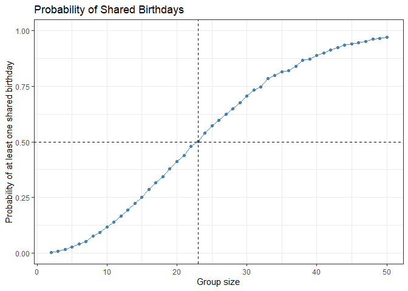
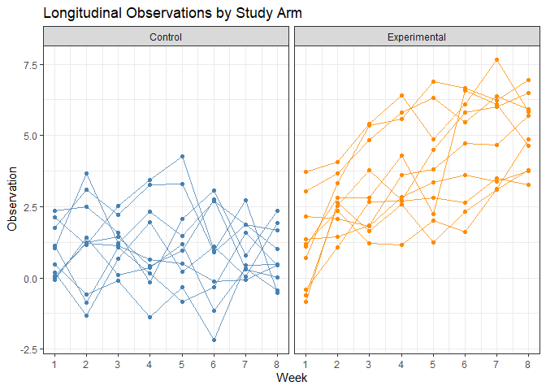
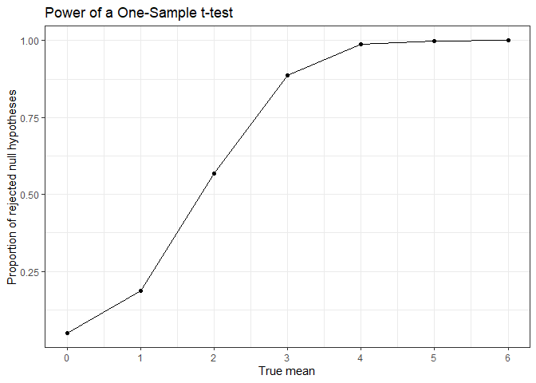
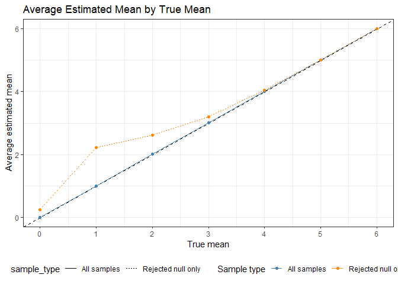

Data Science HW5
================
Yijia
2026-11-18

## Problem 1

I first write a function that simulates birthdays for a group of `n`
people. Birthdays are sampled with replacement from the integers 1
through 365, and the function returns whether at least one birthday is
duplicated.

``` r
birthday_sim = function(n) {
  
  birthdays = sample(1:365, size = n, replace = TRUE)
  
  any(duplicated(birthdays))
}
```

I use `expand_grid()` to create 10,000 iterations for each group size
from 2 to 50. Since the function returns a logical value, I use
`map_lgl()` and calculate the proportion of simulations with shared
birthdays.

``` r
birthday_results = 
  expand_grid(
    group_size = 2:50,
    iter = 1:10000
  ) |> 
  mutate(
    shared_birthday = map_lgl(group_size, birthday_sim)
  )

birthday_summary = 
  birthday_results |> 
  group_by(group_size) |> 
  summarize(
    probability = mean(shared_birthday)
  )
```

``` r
birthday_summary |> 
  ggplot(aes(x = group_size, y = probability)) +
  geom_line(color = "steelblue") +
  geom_point(size = 1.5, color = "steelblue") +
  geom_hline(yintercept = 0.5, linetype = "dashed") +
  geom_vline(xintercept = 23, linetype = "dashed") +
  scale_y_continuous(limits = c(0, 1)) +
  labs(
    title = "Probability of Shared Birthdays",
    x = "Group size",
    y = "Probability of at least one shared birthday"
  ) +
  theme_bw()
```

<!-- -->

The probability of at least two people sharing a birthday increases as
group size increases. At a group size of 23, the estimated probability
is 0.502, which is approximately 0.5. At a group size of 50, the
estimated probability is 0.972, which is much higher. Shared birthdays
become relatively common even in moderately sized groups because the
number of possible pairs increases with group size.

## Problem 2

I first create a dataframe containing the paths to the participant
files. I use `purrr::map()` to read the CSV files into a list column and
`unnest()` to combine their contents. I then extract the study arm and
subject ID from each filename and reshape the weekly observations into
long format.

``` r
longitudinal_df = 
  tibble(
    file_name = list.files(
      "./data",
      pattern = "^(con|exp)_[0-9]+\\.csv$",
      full.names = TRUE,
      recursive = TRUE
    )
  ) |> 
  mutate(
    data = purrr::map(file_name, read_csv)
  ) |> 
  unnest(data) |> 
  mutate(
    file_name = basename(file_name),
    file_name = str_remove(file_name, "\\.csv$")
  ) |> 
  separate(
    file_name,
    into = c("arm", "subject_id"),
    sep = "_"
  ) |> 
  mutate(
    arm = recode(arm, "con" = "Control", "exp" = "Experimental"),
    subject_id = str_c(arm, "_", subject_id)
  ) |> 
  pivot_longer(
    starts_with("week_"),
    names_to = "week",
    values_to = "observation",
    names_prefix = "week_"
  ) |> 
  mutate(week = as.numeric(week))

longitudinal_df |> 
  group_by(arm) |> 
  summarize(
    n_subjects = n_distinct(subject_id),
    n_observations = n()
  ) |> 
  kable(
    col.names = c("Study arm", "Participants", "Observations")
  )
```

| Study arm    | Participants | Observations |
|:-------------|-------------:|-------------:|
| Control      |           10 |           80 |
| Experimental |           10 |           80 |

The tidy dataset contains 160 observations from 20 participants, with 10
participants in the control arm and 10 participants in the experimental
arm, across 8 weeks of observation. Each row represents an observation
for one participant at a given week. The study arm is included in
`subject_id` to ensure that participants with the same numerical ID in
different arms are uniquely identified.

``` r
longitudinal_df |> 
  ggplot(aes(x = week, y = observation, group = subject_id, color = arm)) +
  geom_line(alpha = 0.8, linewidth = 0.6) +
  geom_point(size = 1.5) + 
  facet_grid(. ~ arm) +
  scale_x_continuous(breaks = 1:8) +
  labs(
    title = "Longitudinal Observations by Study Arm",
    x = "Week",
    y = "Observation"
  ) +
  scale_color_manual(
    values = c(
      "Control" = "steelblue",
      "Experimental" = "darkorange"
    )
  ) +
  theme_bw() +
  theme(legend.position = "none")
```

<!-- -->

The spaghetti plot shows the individual trajectories in each study arm.
The control group appears relatively stable over time, while the
experimental group generally shows an increasing trend. There is
variation among participants in both groups, and the difference between
groups appears more pronounced in later weeks. These patterns are
descriptive and do not establish statistical significance.

## Problem 3

I simulate samples of size 30 from a normal distribution with standard
deviation 5 and true mean ranging from 0 to 6. For each sample, I
conduct a two-sided one-sample t-test of $H_0: \mu = 0$ at the 0.05
significance level and retain the estimated mean and p-value.

``` r
sim_t_test = function(mu, n = 30, sigma = 5) {
  
  sim_data = rnorm(n, mean = mu, sd = sigma)
  
  t.test(sim_data, mu = 0) |> 
    broom::tidy() |> 
    select(estimate, p.value) |> 
    rename(
      mu_hat = estimate,
      p_value = p.value
    )
}
```

Using `expand_grid()`, `map()`, and `unnest()`, I repeat the simulation
5,000 times for each value of the true mean.

``` r
sim_results_df = 
  expand_grid(
    true_mu = 0:6,
    iter = 1:5000
  ) |> 
  mutate(
    estimate_df = map(true_mu, sim_t_test)
  ) |> 
  unnest(estimate_df)
```

### Power of the test

For each true mean, the proportion of simulations with a p-value below
0.05 gives the estimated rejection probability.

``` r
power_df = 
  sim_results_df |> 
  group_by(true_mu) |> 
  summarize(
    power = mean(p_value < 0.05)
  )
```

``` r
power_df |> 
  ggplot(aes(x = true_mu, y = power)) +
  geom_line(color = "steelblue") +
  geom_point(color = "steelblue") +
  geom_hline(
    yintercept = 0.05,
    linetype = "dashed"
  ) +
  scale_x_continuous(breaks = 0:6) +
  scale_y_continuous(limits = c(0, 1)) +
  labs(
    title = "Power of a One-Sample t-test",
    x = "True mean",
    y = "Proportion of rejected null hypotheses"
  ) +
  theme_bw()
```

<!-- -->

When the true mean is zero, the proportion of rejected null hypotheses
is 0.05, which is close to the significance level of 0.05 and represents
the Type I error rate. As the true mean increases, the power of the test
increases and approaches 1. With fixed sample size and variance, larger
effect sizes are easier to detect.

### Average estimated means

I compare the average estimated mean across all simulated samples with
the average estimated mean among samples for which the null hypothesis
is rejected.

``` r
estimate_summary = 
  sim_results_df |> 
  group_by(true_mu) |> 
  summarize(
    mean_estimate = mean(mu_hat),
    mean_rejected = mean(mu_hat[p_value < 0.05])
  )
```

``` r
estimate_summary |> 
  pivot_longer(
    mean_estimate:mean_rejected,
    names_to = "sample_type",
    values_to = "average_estimate"
  ) |> 
  mutate(
    sample_type = recode(
      sample_type,
      "mean_estimate" = "All samples",
      "mean_rejected" = "Rejected null only"
    )
  ) |> 
  ggplot(
    aes(
      x = true_mu,
      y = average_estimate,
    color = sample_type,
      linetype = sample_type
    )
  ) + 
  geom_abline(intercept = 0, slope = 1, linetype = "dashed") +
  geom_line() +
  geom_point() +
  scale_x_continuous(breaks = 0:6) +
  labs(
    title = "Average Estimated Mean by True Mean",
    x = "True mean",
    y = "Average estimated mean",
    color = "Sample type"
  ) +
  scale_color_manual(
    values = c(
      "All samples" = "steelblue",
      "Rejected null only" = "darkorange"
    )
  ) +
  theme_bw() +
  theme(legend.position = "bottom")
```

<!-- -->

The average estimate across all simulated samples is approximately equal
to the true mean, which is consistent with the sample mean being an
unbiased estimator. However, when the true mean is small and positive,
the average estimate among samples for which the null hypothesis is
rejected tends to be larger than the true mean. When power is low,
samples with unusually large estimated effects are more likely to
produce statistically significant results. Selecting only statistically
significant samples therefore introduces selection bias.

As the true mean increases and power approaches 1, nearly all samples
lead to rejection, and the difference between the two averages becomes
smaller. When the true mean is zero, the conditional average estimate is
theoretically zero because the two-sided test selects extreme estimates
in both directions. The slight deviation from zero observed in the
simulation can be attributed to Monte Carlo variability and the
relatively small number of rejected samples.
